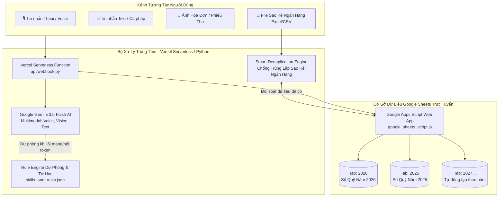

# 🦷 AutoAccounting v1.1 - Trợ Lý Quản Lý Thu Chi Phòng Khám Nha Khoa

[](https://github.com/phuong95st/AutoAccounting/releases)
[](https://ai.google.dev/)
[](https://sheets.google.com/)
[](https://vercel.com/)
[](LICENSE)

Hệ thống quản lý, phân loại và đối soát thu chi tự động thông minh dành riêng cho **Phòng khám Răng / Nha khoa**. 
Dữ liệu được lưu trữ tập trung **100% trên Google Sheets trực tuyến**, phân chia **mỗi năm một Sheet (tab) riêng**, tích hợp **AI nhận diện giọng nói**, **bóc tách ảnh hóa đơn**, **chống trùng lặp dữ liệu sao kê ngân hàng** và **bộ lệnh báo cáo tài chính đa chiều**.

---

## 🌟 Điểm Nổi Bật Của Hệ Thống

* 🎙️ **Kế toán Giọng nói (Gemini Multimodal Voice AI):**
  * Nhấn giữ nút Micro trên Telegram nói tự nhiên: *"Thu chị Quỳnh 500k tiền khám răng"* hoặc *"Chi 70 nghìn mua hoa quả thắp hương"*.
  * AI tự động chuyển hóa âm thanh, trích xuất số tiền, phân loại danh mục nha khoa, hiển thị lại lời thoại và ghi vào sổ quỹ trong 2 giây.
* 💬 **Nhập liệu siêu tốc 3 giây:**
  * Nhập liệu tự nhiên như nhắn tin trò chuyện: `+ 500k tram rang`, `+ 2tr ck khach Trang boc su`, `- 1.2tr ck labo rang su chi Nga`.
* 📑 **Quản trị Đa niên độ trên Google Sheets (Multi-Year Sheets):**
  * Dữ liệu mỗi năm được lưu trữ trong một **Tab riêng biệt** (`2026`, `2025`, `2027`...).
  * Tự động khởi tạo tab mới khi sang năm mới với tiêu đề chuẩn 9 cột, màu sắc phân loại (**THU xanh lá đậm**, **CHI đỏ đậm**), cố định dòng 1 và định dạng tiền tệ `#,##0 ₫`.
* 🛡️ **Động cơ Chống trùng lặp Dữ liệu (Smart Deduplication Engine):**
  * Khi xuất file sao kê ngân hàng (.xlsx, .csv) cuối tháng tải vào bot, hệ thống tự động so khớp đa chiều (số tiền, ngày ±2 ngày, hình thức CK, từ khóa tên bệnh nhân/dịch vụ).
  * **Tự động nhận diện và bỏ qua các khoản đã nhập bằng giọng nói/tin nhắn trước đó**, tuyệt đối không bị cộng dồn doanh thu 2 lần!
* 📊 **Bộ lệnh Báo cáo & Phân tích Tài chính Đa chiều:**
  * Tra cứu thu chi theo ngày cụ thể (`/ngay [dd/mm]`).
  * Báo cáo theo khoảng thời gian tùy ý (`/khoang <từ> <đến>`).
  * Tổng kết tháng chỉ định (`/thang [mm/yyyy]`).
  * Báo cáo tài chính cả năm kèm bảng kết quả từng tháng T01 ➔ T12 (`/nam [yyyy]`).
* 📸 **Quét hóa đơn giấy (Gemini Vision OCR):**
  * Chụp ảnh hóa đơn mua thuốc/vật tư gửi vào bot, AI tự trích xuất số tiền và phân loại chi phí.
* 🎓 **Dual-Engine & Tự học (Self-Learning):**
  * Dự phòng tự động bằng **Rule Engine** khi mất mạng/hết token.
  * Dạy từ khóa danh mục mới cho AI ngay khi đang chat qua lệnh `/hoc`.
* 🚀 **Triển khai Serverless Vercel 24/7:**
  * Hoạt động bền bỉ, ổn định, chi phí vận hành **0 đồng**, không cần treo máy tính cá nhân.

---

## 🏗️ Sơ Đồ Kiến Trúc Hệ Thống



---

## 📌 Bảng Tra Cứu Lệnh Telegram

| Lệnh | Cú pháp ví dụ | Mô tả chi tiết |
| :--- | :--- | :--- |
| **`/today`** | `/today` | Xem nhanh tổng thu, tổng chi, tồn tiền mặt và chuyển khoản hôm nay. |
| **`/ngay`** | `/ngay 13/10`<br>`/ngay 13/10/2026` | Xem báo cáo thu chi và **danh sách chi tiết các giao dịch trong ngày chỉ định**. |
| **`/khoang`** | `/khoang 01/10 14/10`<br>`/khoang 01/10/2026 14/10/2026` | Báo cáo tài chính theo khoảng thời gian bất kỳ, phân tích top chi phí và nguồn thu lớn nhất. |
| **`/thang`** | `/thang`<br>`/thang 9`<br>`/thang 10/2026` | Báo cáo tài chính tháng chỉ định (Doanh thu, chi phí, lợi nhuận ròng, cơ cấu danh mục). |
| **`/nam`** | `/nam`<br>`/nam 2026` | **Báo cáo tài chính cả năm:** Doanh thu, chi phí, lợi nhuận ròng cả năm + **Bảng kết quả từng tháng (T01 ➔ T12)**. |
| **`/ds`** | `/ds` | Xem 10 giao dịch gần nhất vừa nhập kèm mã `#ID`. |
| **`/xoa`** | `/xoa 12` | Xóa giao dịch nếu nhập nhầm (tự tìm kiếm và xóa trên tất cả các tab năm). |
| **`/sheet`** | `/sheet` | Lấy link mở trực tiếp file Google Sheets online trên iPhone hoặc máy tính. |
| **`/excel`** | `/excel` | Tải file Excel Sổ Quỹ mới nhất về máy để lưu trữ hoặc nộp báo cáo thuế. |
| **`/hoc`** | `/hoc tẩy trắng = thu: Doanh thu Dịch vụ` | Dạy từ khóa mới cho AI và Rule Engine. |
| **`/id`** | `/id` | Lấy Telegram User ID để cấu hình phân quyền bảo mật. |
| **`/help`** | `/help` | Mở cẩm nang hướng dẫn sử dụng chi tiết ngay trong khung chat. |

---

## 💬 Cẩm Nang Ghi Chép Hàng Ngày

### 1. Nhập bằng Giọng nói (Voice):
* Bấm giữ biểu tượng **Micro** trên Telegram:
  * *"Thu chị Quỳnh 500k khám răng"*
  * *"Khách Trang chuyển khoản 2 triệu làm răng sứ"*
  * *"Chi 1 triệu 2 chuyển khoản labo răng sứ chị Nga"*
  * *"Chi 70 nghìn mua hoa quả thắp hương"*
* ➡️ Bot phản hồi lại lời thoại và ghi nhận vào đúng tab năm trên Google Sheets!

### 2. Nhập bằng Tin nhắn nhanh (3 giây):
* **Thu tiền:**
  * `+ 500k tram rang` (Thu tiền mặt)
  * `+ 2tr ck khach Trang boc rang su` (Thu chuyển khoản)
  * `thu 350.000 nho rang`
* **Chi tiền:**
  * `- 70k hoa qua thap huong` (Chi tiền mặt)
  * `- 1.2tr ck labo rang su chi Nga` (Chi chuyển khoản)
  * `- 150k mua gang tay y te`

### 3. Nhập sao kê ngân hàng & Đối soát tự động:
* Cuối tháng, xuất file sao kê Excel (`.xlsx`, `.xls`) hoặc `.csv` từ Internet Banking (Vietcombank, Techcombank, MBBank, ACB, VPBank, BIDV...).
* Kéo thả file vào khung chat Telegram:
  * Hệ thống tự động phân tích toàn bộ giao dịch.
  * Tự động lọc ra những giao dịch **đã được nhập tay/nói trước đó** để bỏ qua.
  * Chỉ lưu các giao dịch mới, xuất báo cáo đối soát chi tiết:
    > 🎉 **ĐỐI SOÁT & NHẬP SAO KÊ THÀNH CÔNG!**  
    > • Tổng số giao dịch trong file: **25**  
    > • ✅ Giao dịch mới đã lưu: **24**  
    > • 🛡️ **Giao dịch trùng lặp bỏ qua: 1**  
    > 🔎 *Chi tiết:* `+500.000 ₫` ngày 13/10: Khớp với GD `#12` *(Thu chị Quỳnh tiền khám răng)*  
    > • 🟢 Tổng tiền vào (Thu mới): **45.000.000 ₫**  
    > • 🔴 Tổng tiền ra (Chi mới): **12.500.000 ₫**

---

## 🚀 Hướng Dẫn Cài Đặt & Triển Khai

### 1. Thiết lập Google Sheets Webhook (1 phút):
1. Tạo một file Google Sheets mới (hoặc mở file sổ quỹ hiện có).
2. Vào menu **Tiện ích mở rộng (Extensions)** ➔ **Apps Script**.
3. Dán toàn bộ nội dung file [`google_sheets_script.js`](google_sheets_script.js) vào.
4. Bấm **Triển khai (Deploy)** ➔ **Quản lý bản triển khai (Manage deployments)**:
   * **Loại:** Web App
   * **Thực thi dưới quyền (Execute as):** Tôi (Chủ tài khoản Google)
   * **Ai có quyền truy cập (Who has access):** **Bất kỳ ai (Anyone)** *(Bắt buộc để bot kết nối được)*.
5. Sao chép **URL ứng dụng web** (dạng `https://script.google.com/macros/s/.../exec`).

### 2. Triển khai Serverless Miễn Phí lên Vercel:
1. Đăng ký tài khoản miễn phí tại [vercel.com](https://vercel.com).
2. Import repository **`AutoAccounting`** từ GitHub của bạn.
3. Cấu hình các biến môi trường (**Environment Variables**) trên Vercel:
   ```env
   TELEGRAM_BOT_TOKEN=token_bot_lay_tu_BotFather
   GEMINI_API_KEY_PRIMARY=api_key_gemini_chinh
   GEMINI_API_KEY_BACKUP=api_key_gemini_du_phong
   GEMINI_MODEL=gemini-3.5-flash
   GOOGLE_SHEETS_WEBHOOK_URL=https://script.google.com/macros/s/.../exec
   GOOGLE_SHEETS_URL=https://docs.google.com/spreadsheets/d/.../edit
   ALLOWED_TELEGRAM_USERS=id_telegram_cua_ban
   ```
4. Bấm **Deploy**. Sau khi hoàn tất, Vercel cấp cho bạn URL (VD: `https://auto-accounting-xi.vercel.app`).
5. Kích hoạt Webhook Telegram bằng cách mở trình duyệt truy cập:
   ```text
   https://api.telegram.org/bot<TOKEN>/setWebhook?url=https://<TEN_MIEN_VERCEL>/api/webhook
   ```
   Trình duyệt báo `{"ok":true,"result":true,"description":"Webhook was set"}` là hệ thống đã hoạt động hoàn toàn tự động 24/7!

---

## 🔒 Phân Quyền & Bảo Mật

* **Khóa quyền dùng Bot:** Điền Telegram User ID của bạn (lấy từ lệnh `/id`) vào biến `ALLOWED_TELEGRAM_USERS`. Người lạ chat vào bot sẽ bị từ chối phục vụ.
* **Bảo vệ Google Sheets:** Bấm nút **Chia sẻ (Share)** trên Google Sheets và chỉ cấp quyền **Người xem (Viewer)** cho nhân viên/cộng sự. Chỉ chủ phòng khám và Bot mới có quyền ghi sửa dữ liệu.

---

## 📄 Bản Quyền & Giấy Phép
Dự án được xây dựng phục vụ nhu cầu quản lý tài chính phòng khám nha khoa tự động, mã nguồn mở và miễn phí sử dụng.  
Release Version: **v1.1** (Tháng 10/2026).
