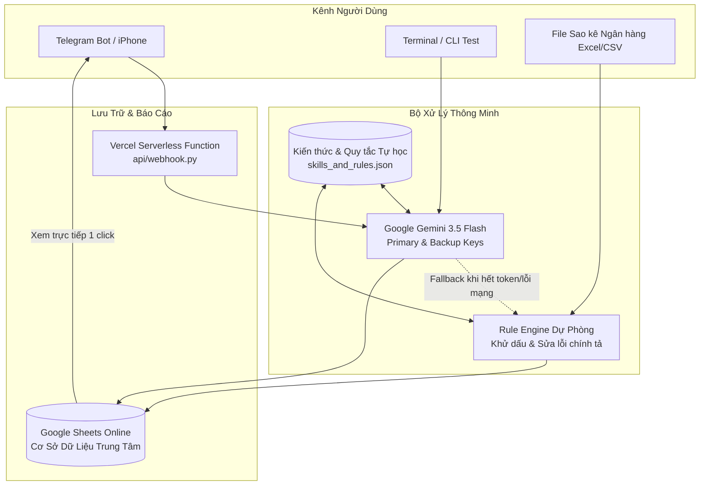

# 🦷 AutoAccounting v1.0 - Trợ Lý Quản Lý Thu Chi Phòng Khám Nha Khoa

[](https://github.com/phuong95st/AutoAccounting/releases)
[](https://ai.google.dev/)
[](https://sheets.google.com/)
[](https://vercel.com/)

Hệ thống quản lý, phân loại và đối soát thu chi tự động thông minh dành riêng cho **Phòng khám Răng / Nha khoa**. 
Dữ liệu tập trung **100% trên Google Sheets trực tuyến**, không cần cài đặt cơ sở dữ liệu phức tạp, hoạt động bền bỉ 24/7 trên máy tính hoặc cloud miễn phí Vercel.

---

## 🌟 Điểm Nổi Bật Của Phiên Bản v1.0

- ⚡ **Ghi chép thu chi 3 giây trên iPhone / Telegram**: Nhập liệu tự nhiên như nhắn tin trò chuyện (`+ 500k tram rang`, `- 70k hoa qua thap huong`...).
- 🎙️ **Nhận diện Giọng nói (Gemini Multimodal Voice AI)**: Chỉ cần giữ nút Micro nói tự nhiên (VD: *"Hôm nay thu bạn Linh 5 triệu niềng răng chuyển khoản nhé"*), bot tự nghe, hiển thị lại lời thoại và ghi sổ ngay tức thì.
- 🧠 **Trí tuệ nhân tạo Gemini 3.5 Flash**: Tự động nhận diện số tiền, nội dung, phân loại danh mục nha khoa, dung lỗi chính tả và tiếng Việt không dấu.
- 🛡️ **Dual-Engine & Tự học (Self-Learning)**: Tự động chuyển đổi sang **Rule Engine** khi AI mất mạng hoặc hết token. Bạn có thể dạy từ mới cho bot ngay khi chat qua lệnh `/hoc`.
- 📊 **Cơ sở dữ liệu Google Sheets trực tuyến**: 
  - Toàn bộ dữ liệu nằm trên 1 file Google Sheets duy nhất.
  - Phân quyền chặt chẽ: Chỉ chủ phòng khám và Bot mới có quyền ghi, người khác chỉ có quyền xem.
  - Tô màu thông minh: **THU màu xanh**, **CHI màu đỏ**, số tiền định dạng tiền tệ `#,##0 ₫`.
- 📸 **Quét hóa đơn / Biên lai (Gemini Vision OCR)**: Chụp ảnh hóa đơn mua vật tư gửi vào bot, AI tự bóc tách số tiền và ghi vào sổ quỹ.
- 📑 **Đối soát Sao kê Ngân hàng cuối tháng**: Gửi file Excel sao kê (VCB, TCB, MB, ACB...), bot tự động nạp toàn bộ danh sách giao dịch lên Google Sheets trong 1 giây.
- 🚀 **Sẵn sàng triển khai Vercel Serverless**: Chạy vĩnh viễn 24/7 với chi phí **0 đồng**, không cần treo máy tính.

---

## 🏗️ Kiến Trúc Hệ Thống (Cloud-Native)



---

## 💬 Cẩm Nang Sử Dụng Hàng Ngày Trên Telegram

### 1. Nhập nhanh thu tiền (Khách thanh toán):
* `+ 500k khach tram rang` ➡️ Thu tiền mặt: 500.000 ₫, Doanh thu Dịch vụ.
* `+ 2tr ck khach Trang boc rang su` ➡️ Khách CK: 2.000.000 ₫, Doanh thu Dịch vụ.
* `thu 350.000 nho rang` ➡️ Thu tiền mặt: 350.000 ₫.

### 2. Nhập nhanh chi tiền (Chi phí phòng khám):
* `- 70k hoa qua thap huong` ➡️ Chi tiền mặt: 70.000 ₫, Tâm linh & Sinh hoạt.
* `- 1.2tr ck labo rang su chi Nga` ➡️ Chi CK: 1.200.000 ₫, Chi phí Labo.
* `- 150k mua gang tay y te` ➡️ Chi tiền mặt: 150.000 ₫, Vật tư & Thuốc men.

### 3. Nhập liệu bằng Giọng nói (Voice Message):
* Nhấn giữ biểu tượng **Micro** trên Telegram và nói tự nhiên:
  * *"Thu 500k trám răng tiền mặt"*
  * *"Chị Linh chuyển khoản 5 triệu tiền niềng răng"*
  * *"Chi 70 nghìn mua hoa quả thắp hương"*
* ➡️ Gemini Voice AI tự động nghe hiểu, phản hồi lại đoạn text vừa nghe được (`🎙 Lời thoại: ...`) và ghi sổ ngay lập tức!

### 4. Gửi ảnh hóa đơn giấy:
Chụp ảnh hóa đơn mua thuốc/vật tư gửi trực tiếp vào bot, Gemini Vision tự động nhận diện và lưu vào Google Sheets.

### 5. Cuối tháng - Nhập sao kê ngân hàng:
Kéo thả file Excel/CSV sao kê ngân hàng vào bot, hệ thống tự động bóc tách từng dòng và đẩy lên Google Sheets trong 1 lần gọi.

---

## 📌 Danh Sách Lệnh Quản Trị (Menu Lệnh Telegram)

| Lệnh | Ý nghĩa & Hướng dẫn sử dụng |
| :--- | :--- |
| **`/sheet`** | **Mở trực tiếp Sổ Quỹ Google Sheets online trên điện thoại bằng 1 click.** |
| **`/today`** | **Xem nhanh hôm nay:** Tổng thu, tổng chi, tồn tiền mặt, chuyển khoản. |
| **`/thang`** | **Xem tổng kết tháng này:** Doanh thu, chi phí, lợi nhuận ròng và cơ cấu các khoản chi lớn nhất. |
| **`/ds`** | **Xem 10 giao dịch gần nhất** vừa nhập để kiểm tra mã ID. |
| **`/xoa <id>`** | **Xóa giao dịch nhập nhầm** (Ví dụ: `/xoa 12` ➡️ Tự động xóa dòng 12 trên Google Sheets). |
| **`/excel`** | **Tải file Excel của Google Sheets về máy** để lưu trữ offline. |
| **`/hoc`** | **Dạy từ khóa mới cho AI:** Cú pháp: `/hoc <từ khóa> = <thu/chi>: <danh mục>` |
| **`/id`** | **Hiển thị Telegram User ID của bạn** để phục vụ phân quyền bảo mật. |
| **`/help`** | **Mở cẩm nang hướng dẫn sử dụng nhanh.** |

---

## 🚀 Hướng Dẫn Cài Đặt & Triển Khai

### Cách 1: Chạy trực tiếp trên Máy tính (Local)

1. **Cài đặt thư viện phụ thuộc:**
   ```bash
   pip install -r requirements.txt
   ```
2. **Cấu hình file `.env`:**
   ```env
   # Gemini API Keys
   GEMINI_API_KEY_PRIMARY=key_chinh_cua_ban
   GEMINI_API_KEY_BACKUP=key_phu_cua_ban
   GEMINI_MODEL=gemini-3.5-flash

   # Telegram Bot Token (Lấy từ @BotFather)
   TELEGRAM_BOT_TOKEN=token_bot_telegram_cua_ban

   # Google Sheets Integration
   GOOGLE_SHEETS_WEBHOOK_URL=https://script.google.com/macros/s/.../exec
   GOOGLE_SHEETS_URL=https://docs.google.com/spreadsheets/d/.../edit

   # Phân quyền (Tùy chọn: Dán ID từ lệnh /id để khóa bot chỉ cho bạn dùng)
   ALLOWED_TELEGRAM_USERS=
   ```
3. **Khởi động bot:**
   ```bash
   python bot.py
   ```

---

### Cách 2: Triển khai Miễn Phí 24/7 lên Vercel (Không cần bật máy tính)

1. Đăng nhập [vercel.com](https://vercel.com) ➡️ Bấm **Add New Project** ➡️ Import repository **`AutoAccounting`**.
2. Thêm các biến môi trường từ `.env` vào mục **Environment Variables** trên Vercel.
3. Bấm **Deploy**. Vercel sẽ cấp cho bạn tên miền (VD: `https://auto-accounting.vercel.app`).
4. Mở trình duyệt web và kích hoạt Webhook:
   ```text
   https://api.telegram.org/bot<TOKEN>/setWebhook?url=https://<TEN_MIEN_VERCEL>/api/webhook
   ```
   Trình duyệt báo `{"ok":true}` là bot sẽ chạy tự động mãi mãi trên đám mây!

---

## ⚠️ Lưu Ý Quan Trọng Khi Thiết Lập Google Sheets

Khi triển khai Google Apps Script ([`google_sheets_script.js`](google_sheets_script.js)):
* Ở mục **Người có quyền truy cập (Who has access)**: **BẮT BUỘC PHẢI CHỌN "BẤT KỲ AI" (ANYONE)**.
  *(Nếu chọn "Bất kỳ ai có tài khoản Google", bot sẽ bị chặn lỗi `HTTP 401 Unauthorized` vì bot không thể đăng nhập Google)*.
* Để khóa không cho người khác chỉnh sửa bảng tính:
  - Bấm **Chia sẻ (Share)** trên Google Sheets ➡️ Đặt quyền là **"Người xem" (Viewer)**.
  - Bot vẫn ghi thêm dòng được bình thường vì bot chạy dưới quyền Chủ sở hữu của bạn.

---

## 📄 Bản Quyền & Giấy Phép
Dự án được xây dựng phục vụ nhu cầu quản lý tài chính phòng khám nha khoa tự động, mã nguồn mở và miễn phí sử dụng.
Release Version: **v1.0** (Tháng 10/2026).
