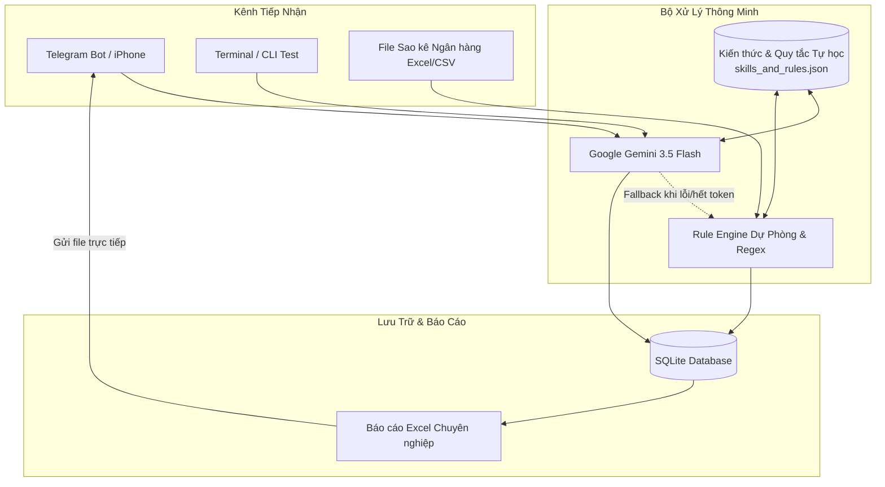

# 🦷 AutoAccounting - Trợ Lý Quản Lý Thu Chi Phòng Khám Nha Khoa

Hệ thống quản lý, phân loại và đối soát thu chi tự động thông minh dành riêng cho **Phòng khám Răng / Nha khoa**:
- ⚡ **Ghi chép siêu tốc qua Telegram Bot**: Nhập liệu 3 giây trên điện thoại (`+ 500k tram rang`, `- 70k hoa qua thap huong`...).
- 🧠 **Trí tuệ nhân tạo Gemini AI**: Tự động nhận diện số tiền, nội dung, hình thức thanh toán và phân loại danh mục nha khoa chuẩn xác.
- 🛡️ **Cơ chế Fallback & Tự học (Self-Learning)**: Nếu AI quá tải/hết token, hệ thống tự động kích hoạt **Rule Engine** dự phòng, không bao giờ gián đoạn. Người dùng có thể dạy từ mới cho bot ngay trong khi chat.
- 📸 **Quét hóa đơn / Biên lai (OCR)**: Chụp ảnh hóa đơn mua vật tư gửi vào bot, Gemini Vision tự bóc tách số tiền.
- 📑 **Đối soát Sao kê Ngân hàng cuối tháng**: Kéo thả file Excel sao kê ngân hàng (VCB, TCB, MB, ACB...), hệ thống tự động bóc tách và khớp sổ quỹ.
- 📊 **Xuất Báo cáo Excel chuyên nghiệp**: Tự động sinh file Excel với Dashboard, phân tích cơ cấu chi phí, tổng kết thu chi và lợi nhuận ròng.

---

## 🏗️ Kiến Trúc Hệ Thống



---

## 🚀 Hướng Dẫn Cài Đặt & Chạy

### 1. Cài đặt môi trường
Đảm bảo máy đã cài Python (>= 3.10). Cài đặt các thư viện phụ thuộc:
```bash
pip install -r requirements.txt
```

### 2. Cấu hình file `.env`
Mở file `.env` và kiểm tra cấu hình:
```env
# Gemini API Keys (Lấy từ Google AI Studio)
GEMINI_API_KEY_PRIMARY=your_gemini_api_key_primary
GEMINI_API_KEY_BACKUP=your_gemini_api_key_backup
GEMINI_MODEL=gemini-3.5-flash

# Telegram Bot Token (Lấy từ @BotFather trên Telegram)
TELEGRAM_BOT_TOKEN=dien_token_cua_ban_vao_day

```

#### Cách tạo Bot Telegram miễn phí trong 1 phút:
1. Mở Telegram trên điện thoại hoặc máy tính, tìm kiếm **`@BotFather`**.
2. Bấm `Start` và gửi lệnh: `/newbot`.
3. Đặt tên hiển thị cho Bot (Ví dụ: `KeToanNhaKhoaBot`).
4. Đặt username kết thúc bằng chữ `bot` (Ví dụ: `phuong_ketoan_bot`).
5. BotFather sẽ gửi cho bạn một chuỗi **HTTP API Token** (dạng `123456789:ABCdefGhIJKlmNo...`).
6. Dán chuỗi Token này vào biến `TELEGRAM_BOT_TOKEN` trong file `.env`.

### 3. Khởi động Bot
```bash
python bot.py
```
Sau khi chạy, bạn chỉ cần mở Telegram trên iPhone tìm bot của mình và bấm `/start`!

---

## 💬 Hướng Dẫn Sử Dụng Hàng Ngày Trên Telegram

### 1. Nhập nhanh thu tiền:
* `+ 500k tram rang` ➡️ Thu tiền mặt: 500.000 ₫, Doanh thu Dịch vụ.
* `+ 2tr ck khach Mai boc rang su` ➡️ Khách CK: 2.000.000 ₫, Doanh thu Dịch vụ.
* `thu 350.000 nho rang` ➡️ Thu tiền mặt: 350.000 ₫.

### 2. Nhập nhanh chi tiền:
* `- 70k hoa qua thap huong` ➡️ Chi tiền mặt: 70.000 ₫, Tâm linh & Sinh hoạt.
* `- 1.2tr ck labo rang su chi Nga` ➡️ Chi CK: 1.200.000 ₫, Chi phí Labo.
* `- 150k mua gang tay y te` ➡️ Chi tiền mặt: 150.000 ₫, Vật tư & Thuốc men.

### 3. Gửi ảnh hóa đơn:
Chụp ảnh hóa đơn mua thuốc/vật tư gửi trực tiếp vào bot, AI Gemini Vision sẽ tự động đọc số tiền và lưu vào sổ quỹ.

### 4. Cuối tháng - Nhập sao kê ngân hàng:
Gửi file Excel/CSV sao kê ngân hàng vào bot, hệ thống sẽ tự động bóc tách từng dòng giao dịch và lưu vào database.

### 5. Các lệnh báo cáo & quản trị:
* `/today` hoặc `/ngay`: Xem tổng kết thu - chi - chênh lệch hôm nay.
* `/thang` hoặc `/baocao`: Xem báo cáo doanh thu, chi phí, lợi nhuận tháng này.
* `/excel`: Xuất file Excel báo cáo hoàn chỉnh tải về máy.
* `/ds`: Xem danh sách 10 giao dịch gần nhất kèm mã ID.
* `/xoa <id>`: Xóa giao dịch nếu lỡ tay nhập nhầm (Ví dụ: `/xoa 5`).
* `/hoc <từ khóa> = <thu/chi>: <danh mục>`: Dạy cho AI nhận diện từ mới (Ví dụ: `/hoc cafe = chi: Chi phí Tâm linh & Sinh hoạt`).

---

## 🧪 Thử Nghiệm Nhanh Bằng Dòng Lệnh (CLI Test)

Nếu chưa kịp tạo bot Telegram, bạn có thể chạy thử nghiệm toàn bộ hệ thống ngay trên máy tính bằng lệnh:
```bash
python cli_test.py
```
Màn hình tương tác sẽ cho phép bạn gõ giao dịch, xem báo cáo và xuất file Excel ngay lập tức.
